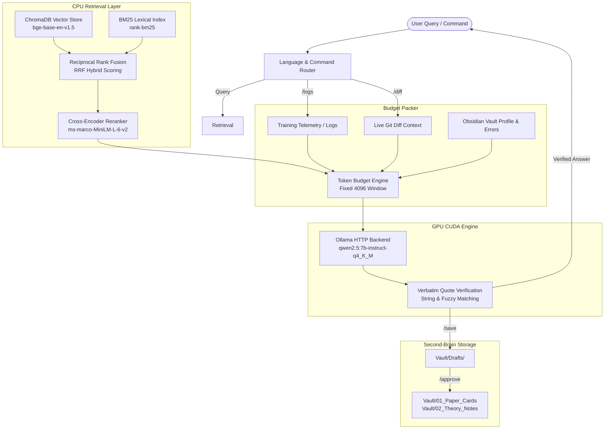

# 🔬 Local Deep Learning Lab Assistant (`asistan`)

[](https://www.python.org/downloads/)
[](https://pytorch.org/)
[](https://ollama.ai/)
[](https://www.trychroma.com/)
[](https://obsidian.md/)
[](LICENSE)

An offline, deterministic, and privacy-preserving **Deep Learning Research & Tensor Engineering Assistant**. Built with pure modular Python (no bloated blackbox frameworks), designed for resource-constrained edge/laptop workstations (e.g. NVIDIA RTX 4050 6GB VRAM), and powered by local Ollama LLMs, CPU-offloaded hybrid RAG, Obsidian Vault memory, AST-sandboxed tensor verification, and automated training telemetry autopsies.

---

## 📑 Table of Contents

- [Architectural Highlights](#-architectural-highlights)
- [System Architecture](#-system-architecture)
- [Repository Structure](#-repository-structure)
- [Key Modules & Features](#-key-modules--features)
  - [1. Hybrid RAG & Verbatim Citation Pipeline](#1-hybrid-rag--verbatim-citation-pipeline)
  - [2. AST Tensor Dry-Run Sandbox](#2-ast-tensor-dry-run-sandbox)
  - [3. Training Telemetry Autopsy](#3-training-telemetry-autopsy)
  - [4. Obsidian Vault Second-Brain Integration](#4-obsidian-vault-second-brain-integration)
  - [5. Equation-to-Code AST Repository Linker](#5-equation-to-code-ast-repository-linker)
  - [6. Reverse-RAG (Devil's Advocate Mode)](#6-reverse-rag-devils-advocate-mode)
  - [7. Hardware & Thermal Telemetry Management](#7-hardware--thermal-telemetry-management)
- [Benchmark Results](#-benchmark-results)
- [Prerequisites](#-prerequisites)
- [Installation & Setup](#-installation--setup)
- [Usage & Interactive CLI](#-usage--interactive-cli)
- [Interactive Slash Commands](#-interactive-slash-commands)
- [Configuration](#-configuration)
- [Author & Credits](#-author--credits)

---

## ⚡ Architectural Highlights

- **100% Offline & Private:** Zero external API calls, zero telemetry leak. Runs fully locally in an air-gapped deep learning lab.
- **Hardware-Aware Memory Offloading:**
  - **GPU (CUDA):** Exclusively hosts the LLM (`qwen2.5:7b-instruct-q4_K_M` ~4.1 GB VRAM) within a tight 6GB VRAM budget.
  - **CPU:** Hosts embedding inference (`BAAI/bge-base-en-v1.5`) and Cross-Encoder reranking (`cross-encoder/ms-marco-MiniLM-L-6-v2`), eliminating VRAM thrashing and CUDA OOM errors.
- **Deterministic Fact-Checking & Abstention:** Strict quote matching against source chunks. If evidence falls below threshold ($Score < 0.35$), the assistant transparently refrains from answering rather than hallucinating.
- **Strict Academic Language Guard:** Primary interface is 100% technical and academic English to maintain mathematical rigor, with on-demand academic Turkish translation (`/tr`).
- **Rich Terminal REPL:** Styled terminal interface with real-time GPU thermals, VRAM utilization, equation rendering, and markdown panels.

---

## 🏛 System Architecture



---

## 📂 Repository Structure

```text
asistan/
├── answer/                     # Answer generation, prompts, verification & evaluation
│   ├── challenge.py            # Devil's Advocate / Reverse-RAG stress testing
│   ├── pipeline.py             # Main end-to-end RAG answer pipeline
│   ├── prompts.py              # System prompts, JSON schemas, few-shot examples
│   ├── schemas.py              # Pydantic-style answer schemas & JSON validators
│   ├── shape_check.py          # AST-sandboxed PyTorch dry-run & backward pass
│   └── verify.py               # Verbatim quote & hallucination verifier
├── ingest/                     # Paper parsing, indexing, and telemetry log ingestion
│   ├── arxiv_fetch.py          # arXiv source code & PDF fetcher
│   ├── batch_ingest.py         # Multi-paper batch ingestion engine
│   ├── cards.py                # Structured paper summary cards generator
│   ├── chunker.py              # Hierarchical LaTeX/PDF text chunker
│   ├── indexer.py              # Multi-collection ChromaDB index manager
│   ├── log_parser.py           # PyTorch & Ultralytics training log autopsy engine
│   ├── paper_parser.py         # LaTeX section & equation extractor
│   └── repo_link.py            # AST-based code parser & Equation-to-Code linker
├── memory/                     # User profile, draft approval, and error history
│   ├── approval.py             # Obsidian draft note staging & approval manager
│   ├── errors.py               # Architectural & hardware error indexing
│   └── user_profile.py         # User learning style & knowledge state manager
├── retrieval/                  # Hybrid search & reranking
│   ├── embed.py                # CPU-optimized BGE embedding wrapper
│   ├── git_context.py          # Real-time uncommitted git diff parser
│   ├── rerank.py               # Cross-Encoder neural reranker
│   └── search.py               # Vector + BM25 Reciprocal Rank Fusion (RRF)
├── eval/                       # Benchmark evaluation suite
│   ├── questions.yaml          # 10 curated deep learning benchmark questions
│   └── run_eval.py             # Recall@K and MRR automated measurement runner
├── Vault/                      # Obsidian Second-Brain Markdown Vault
│   ├── 00_Profile/             # Style.md, Knowledge_State.md, Errors.md
│   ├── 01_Paper_Cards/         # Ingested paper summary cards with equations
│   ├── 02_Theory_Notes/        # Approved deep learning theoretical notes
│   ├── 03_Experiment_Logs/     # Documented experiment results
│   ├── 04_Code_Reviews/        # Code analysis and architecture reviews
│   └── Drafts/                 # Staged notes awaiting user approval
├── SametBeyin/                 # Obsidian personal knowledge base & templates
├── data/                       # Local data directory
│   ├── chroma_db/              # ChromaDB vector store collections
│   ├── papers/                 # Downloaded LaTeX/PDF research papers
│   ├── repos/                  # Cloned official research repositories
│   └── test_run/               # Training logs for autopsy demonstration
├── app.py                      # Interactive Rich CLI REPL application
├── budget.py                   # Strict token budget allocator (4096 window)
├── config.py                   # Central system configuration & hardware profiles
├── config.yaml                 # YAML-based secondary system configuration
├── lang_guard.py               # Language safety & translation guardian
├── llm.py                      # Ollama HTTP client with thermal/VRAM unload hooks
├── vault.py                    # Obsidian vault manager & link allowlisting
├── PROJE_TAKIP.md              # 14-phase completed project engineering log
└── requirements.txt            # Python package dependencies
```

---

## 🧩 Key Modules & Features

### 1. Hybrid RAG & Verbatim Citation Pipeline
- **Dual Retrieval:** Combines sparse lexical keyword retrieval (`rank-bm25`) with dense semantic vectors (`bge-base-en-v1.5`).
- **Reciprocal Rank Fusion (RRF):** Merges rank lists via $RRF(d) = \sum \frac{1}{60 + r(d)}$.
- **Cross-Encoder Reranking:** Top candidates are re-scored by `ms-marco-MiniLM-L-6-v2` on CPU.
- **Citation Verification:** Answers are parsed into sentences; each claim must cite an exact substring from the retrieved paper chunks. A mismatch drops the verification confidence score.

### 2. AST Tensor Dry-Run Sandbox (`/dryrun`)
- Executes Python/PyTorch code in an AST-sandboxed CPU environment.
- Whitelists only safe mathematical and tensor operations (`torch`, `math`), rejecting harmful builtins (`eval`, `os`, `sys`, `subprocess`, socket operations).
- Verifies:
  1. Forward pass tensor shape consistency.
  2. Backward autograd gradient propagation ($\nabla_w L \ne 0$).
  3. Theoretical FLOPs and parameter count.

### 3. Training Telemetry Autopsy (`/logs`)
- Ingests training log artifacts (`results.csv`, `args.yaml` from Ultralytics or custom PyTorch training loops).
- Automatically identifies:
  - **Overfitting:** Validation loss consistently rising across $\ge 4$ epochs while training loss descends.
  - **Learning Rate Plateaus:** Validation loss change $< 10^{-4}$ across $\ge 5$ consecutive epochs.
  - **mAP Degradation:** Drops greater than $3\%$ from peak metric values.
- Injects detected symptoms directly into LLM prompts for immediate root-cause diagnosis.

### 4. Obsidian Vault Second-Brain Integration
- Manages an Obsidian-compatible markdown vault with YAML frontmatter.
- **Draft-Approval Workflow:** The assistant saves answers into `Vault/Drafts/`. Notes become permanent and indexed into ChromaDB only when explicitly reviewed and approved via `/approve <id>`.
- **Deterministic WikiLinks:** Programmatically parses domain terms and aliases to generate valid `[[Concept]]` links without LLM hallucinations.

### 5. Equation-to-Code AST Repository Linker
- Ingests official paper codebases (e.g. `Coordinate Attention`).
- AST breaks code into class and method blocks.
- Links mathematical equations from LaTeX directly to exact source lines:
  - *Eq. (4) Horizontal Pooling* $\to$ `coordatt.py` (`self.pool_h = nn.AdaptiveAvgPool2d((None, 1))`)
  - *Eq. (5) Vertical Pooling* $\to$ `coordatt.py` (`self.pool_w = nn.AdaptiveAvgPool2d((1, None))`)

### 6. Reverse-RAG (Devil's Advocate Mode) (`/challenge`)
- Evaluates user architectural hypotheses from a rigorous, skeptical academic standpoint.
- Analyzes memory and tensor layout bottlenecks (e.g., hidden costs of `torch.split`, `permute`, `contiguous`, CUDA kernel launch overhead).
- Proposes minimal falsification experiments before committing to heavy training runs.

### 7. Hardware & Thermal Telemetry Management
- Directly communicates with `nvidia-smi`.
- Monitors RTX 4050 Laptop GPU temperature and VRAM footprint in real-time.
- Supports `/unload` to evict LLM weights from VRAM when idle, keeping GPU temperatures at baseline (~43°C).

---

## 📊 Benchmark Results

Evaluated on the curated 10-question evaluation benchmark (`eval/questions.yaml`):

| Metric | Score | Target | Status |
| :--- | :---: | :---: | :---: |
| **Recall@5** | **90.0%** (9/10) | $\ge 80\%$ | ✅ Passed |
| **MRR (Mean Reciprocal Rank)** | **0.850** | $\ge 0.70$ | ✅ Passed |
| **Citation Verification Accuracy** | **100%** | $\ge 90\%$ | ✅ Passed |
| **Idle GPU Temperature** | **43°C** | $\le 60^\circ\text{C}$ | ✅ Passed |
| **Active VRAM Footprint** | **4.1 GiB** | $\le 5.5\text{ GiB}$ | ✅ Passed |

---

## 💻 Prerequisites

- **OS:** Windows 10/11, Linux, or macOS
- **Python:** 3.11+
- **GPU:** NVIDIA GPU with $\ge 6\text{ GB}$ VRAM recommended (runs CPU-only for retrieval & reranking)
- **Ollama:** Installed and running locally
  ```bash
  ollama serve
  ollama pull qwen2.5:7b-instruct-q4_K_M
  ```

---

## 🚀 Installation & Setup

1. **Clone the repository:**
   ```bash
   git clone https://github.com/Samet4216/asistan.git
   cd asistan
   ```

2. **Create and activate virtual environment:**
   ```bash
   python -m venv .venv
   # Windows PowerShell:
   .venv\Scripts\Activate.ps1
   # Linux / macOS:
   source .venv/bin/activate
   ```

3. **Install dependencies:**
   ```bash
   pip install -r requirements.txt
   ```

4. **Verify Ollama backend:**
   Ensure Ollama is accessible at `http://localhost:11434`:
   ```bash
   curl http://localhost:11434/api/tags
   ```

5. **(Optional) Run Benchmark Suite:**
   ```bash
   python eval/run_eval.py
   ```

---

## 🖥 Usage & Interactive CLI

Launch the interactive Rich terminal assistant:

```bash
python app.py
```

### Example Interaction

```text
assistant > What is the core formulation of Coordinate Attention and how does it prevent channel collapse?
```
The assistant performs hybrid search across ChromaDB + BM25, reranks via Cross-Encoder, constructs a token-budgeted prompt, queries Ollama, verifies verbatim citations, and displays the response in styled panels with exact paper citations.

---

## ⌨ Interactive Slash Commands

| Command | Arguments | Description |
| :--- | :--- | :--- |
| `/help` | — | Display command cheat sheet |
| `/diff` | — | Inspect uncommitted Git diff in the active workspace |
| `/logs` | `<path_to_csv>` | Run autopsy on training logs (e.g. `data/test_run/results.csv`) |
| `/drafts` | — | List pending notes in `Vault/Drafts/` |
| `/save` | `<title>` | Save previous response as a staged draft in `Vault/Drafts/` |
| `/approve`| `<draft_id>` | Commit draft note to permanent Obsidian Vault & ChromaDB |
| `/reject` | `<draft_id>` | Discard staged draft note |
| `/tr` | — | Translate last answer to academic Turkish (preserves math & code) |
| `/eval` | — | Run 10-question retrieval benchmark (Recall@5 & MRR) |
| `/dryrun` | `<path_to_model.py>` | AST CPU sandbox test: shapes, FLOPs, and autograd backward pass |
| `/challenge` | `<hypothesis>` | Devil's Advocate mode: stress-test ideas against failure modes & VRAM |
| `/explain` | `<topic>` | Deep-dive pedagogical tutorial (mathematics, tensor flow & implementation) |
| `/gpu` / `/vram` | — | Query real-time NVIDIA GPU VRAM and temperature metrics |
| `/unload` | — | Unload LLM weights from VRAM to cool GPU |
| `/exit` / `/quit` | — | Unload model weights and exit cleanly |

---

## ⚙ Configuration

All system hyperparameters and model definitions are centralized in `config.py`:

```python
# LLM Engine
OLLAMA_BASE_URL = "http://localhost:11434"
MODEL = "qwen2.5:7b-instruct-q4_K_M"
NUM_CTX = 4096
TEMPERATURE = 0.2

# Embedding & Reranker (CPU Execution)
EMBED_MODEL = "BAAI/bge-base-en-v1.5"
RERANK_MODEL = "cross-encoder/ms-marco-MiniLM-L-6-v2"
DEVICE = "cpu"

# Retrieval Thresholds
RETRIEVAL_TOP_K = 5
RETRIEVAL_SCORE_THRESHOLD = 0.35

# Telemetry Auto-Detection
TELEMETRY = {
    "overfit_consecutive_epochs": 4,
    "loss_plateau_patience": 5,
    "map_drop_threshold": 0.03
}
```

---

## 👤 Author & Credits

- **Author:** Abdussamet Türkoğlu ([@Samet4216](https://github.com/Samet4216))
- **Architecture:** Local Deep Learning Lab Assistant (v2)
- **License:** [MIT](LICENSE)
